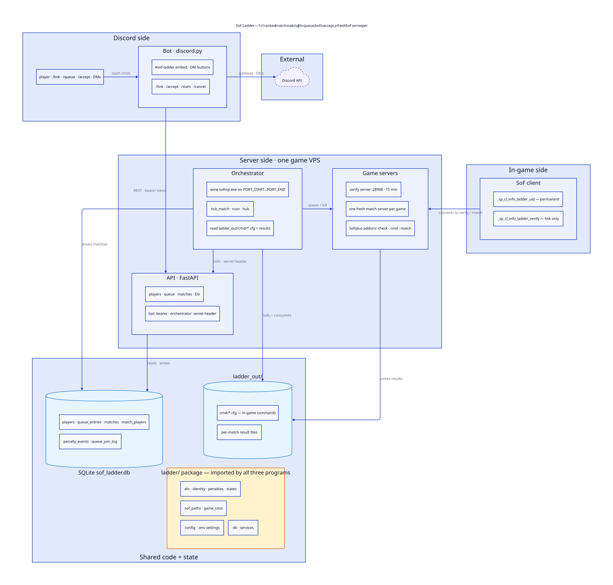

# SoF Ladder — for humans

> Ranked 1v1 matchmaking for Soldier of Fortune: one account per player, an Elo queue, and a fresh dedicated server for every match.

Read it left to right:

- **Discord side** — registration is Discord-only. The bot owns `/link`, the queue buttons and the accept DMs; everything else is a REST call away.
- **Server side · one game VPS** — the API holds players/queue/matches/Elo in SQLite. The orchestrator polls it, spawns `sofmp.exe` under Wine on the next free port, and kills the server when the match ends. Game servers are disposable: verify server, one per match, plus optional hub.
- **In-game side** — a client is identified by `_sp_cl_info_ladder_uid` (permanent cvar), never by nickname. The verify token is one-time.
- **The handoff** — SoFplus addons write results and in-game commands into `ladder_out/`; the orchestrator consumes them and posts back to the API. That directory is the only coupling between the game and the services.

Source: [`docs/system.d2`](docs/system.d2). Edit that, then run `scripts/render-diagram.sh`.
